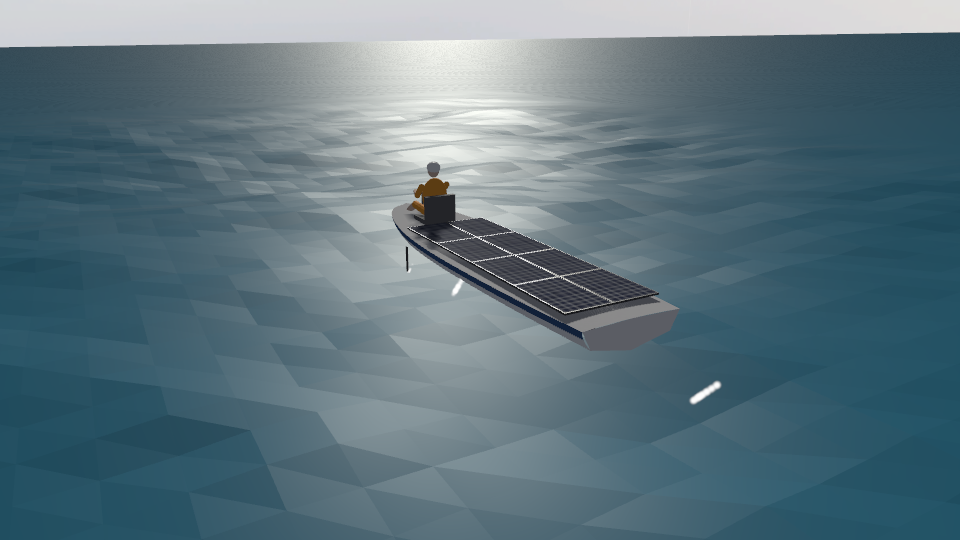

# Hydrofoil-Craft-Control

Hydrofoil-Craft-Control is a physics-based simulator and controller for a small, fully submerged hydrofoil craft. It has two parts:

- **A Python model and controllers.** The model is validated against a published thesis.
- **A Gazebo / ROS 2 simulator.** It runs the same physics in C++.

You fly the craft yourself. You set speed, acceleration and ride height, and you can take over individual foils. You also set the sea state, wind, current and water density while it runs. A model-predictive controller keeps the craft stable underneath.



The vessel is the 215 kg solar-class craft from I. Skounakis-Kounavis, *Dynamic Modeling & Predictive Control of a Hydrofoil Vessel* (diploma thesis, NTUA, 2025), code at [jskoun/MPC_HydrofoilControl](https://github.com/jskoun/MPC_HydrofoilControl). Its design point is 7 m/s, with the centre of gravity 0.3 m above the water. It has three fully rotating foils:
- two fore foils at x = +1.1 m, y = ±0.62 m;
- one aft foil at x = −2.45 m.

This project started as a port of that work and grew into a separate simulator with its own controller. It differs from the reference in several ways:
- A speed-and-height MPC that also commands propeller rpm.
- Operator modes, foil overrides and envelope protection.
- A live environment: sea, wind, current and density.
- Switchable physics upgrades.
- A Gazebo front end.

---

## Contents
- [What is in it](#what-is-in-it)
- [Quick start: Python only](#quick-start-python-only)
- [Quick start: Gazebo simulator](#quick-start-gazebo-simulator)
- [Flying it](#flying-it)
- [Physics fidelity: `ref` and `v2`](#physics-fidelity-ref-and-v2)
- [Validation](#validation)
- [Repository layout](#repository-layout)
- [Assumptions and limitations](#assumptions-and-limitations)
- [Credits and licence](#credits-and-licence)

---

## What is in it

| Layer | What | Where |
|---|---|---|
| Plant model | Reduced 6-DOF rigid body (surge, heave, roll, pitch; sway and yaw locked, as in the thesis) | `hydrofoil/plant.py` |
| Foil physics | Per-foil lift, drag and moment from the NACA 63-412 XFLR5 polar; free-surface lift loss and induced drag; wave and interference drag; Wagner unsteady lift; struts; roll damping; Wageningen-B propeller | `hydrofoil/plant.py` |
| Waves | Linear deep-water waves. Regular, or irregular (ITTC / Pierson-Moskowitz spectrum, optional short-crested spreading); a new sea blends in without a jump | `hydrofoil/waves.py` |
| Environment | Sea state, gusty wind with air drag, current, and water density (set directly or from temperature and salinity, UNESCO 1983) | `hydrofoil/environment.py` |
| Thesis controllers | LQI, LQI-S, LQI-SW, MPC-I/ID/IP/IDP, LPV-MPC (re-implemented; OSQP instead of the MATLAB MPC Toolbox) | `hydrofoil/controllers.py`, `hydrofoil/design.py` |
| Own controller | Speed + ride-height MPC: 7 outputs, 3 foils + rpm, scheduled on speed | `hydrofoil/mpc4.py` |
| Supervisor | Guidance (acceleration-limited speed, height slew), AUTO / ASSIST / MANUAL modes, foil overrides, envelope-protection watchdog | `hydrofoil/supervisor.py` |
| C++ physics | `libfoil`: the same model as `plant.py`, checked against it to about 1e-13 | `ros_ws/src/hydrofoil_physics` |
| Gazebo plugin | `FoilDynamics`: applies the hydrodynamic wrench, owns the wave field, draws the sea surface, simulates a sonar | `ros_ws/src/hydrofoil_physics/src/FoilDynamics.cc` |
| ROS 2 nodes | `control_node` (supervisor + MPC), `env_node` (environment), `hf` command-line tool | `ros_ws/src/hydrofoil_control` |

---

## Quick start: Python only

You need Python 3.11+ on Windows, Linux or macOS.

```bash
python -m venv .venv
.venv/Scripts/activate            # Linux/macOS: source .venv/bin/activate
pip install -r requirements.txt

python -m pytest -q tests                 # linear model vs the thesis
python scripts/validate_linear.py         # trim, A/B matrices, poles vs the thesis
python scripts/step_benchmark.py          # thesis Sec. 5.2.1 step benchmark, all controllers
python scripts/phase2_tests.py            # operator controls: speed, height, modes, overrides, watchdog
python scripts/phase3_tests.py            # environment: density, wind, current, sea-state ladder
python scripts/phase4_tests.py            # physics upgrades (writes a summary like logs/phase4_tests.txt)
```

A minimal closed-loop run:

```python
from hydrofoil.design import build_models, NOMINAL_IDX
from hydrofoil.supervisor import Supervisor
from hydrofoil.environment import Environment
from hydrofoil.sim import simulate_supervised

models = build_models()                      # linearised models, 5..15 m/s
sup, env = Supervisor(models), Environment(seed=0)
events = [(2.0, lambda s, e, t: e.apply({"sea": {"hs": 0.3, "tp": 2.8, "dir": 0}}, t)),
          (5.0, lambda s: s.set_speed(10.0))]
log = simulate_supervised(sup, models[NOMINAL_IDX], T=30.0, events=events, env=env)
print(log["z"].std(), log["u"][-1])
```

---

## Quick start: Gazebo simulator

Tested on WSL2 Ubuntu 26.04 with ROS 2 Lyrical and Gazebo Jetty (gz-sim 10). Rendering uses ogre2, on the GPU through WSLg.

```bash
# in WSL; REPO = this repository as seen from WSL, e.g. /mnt/c/Users/<you>/Hydrofoil-Craft-Control
sudo bash $REPO/setup/phase0_install.sh     # ROS 2 Lyrical, ros_gz bridge, build tools, osqp
bash $REPO/setup/build_ws.sh                # colcon build into ~/hydrofoil_build
bash $REPO/setup/test_libfoil.sh            # C++ physics vs the Python model (golden test)

bash $REPO/setup/launch_gui.sh              # Gazebo window + controller (reference physics)
bash $REPO/setup/launch_gui.sh v2           # ... with the phase 4 physics
```

Or use the launch file directly:

```bash
source $REPO/setup/env.sh
ros2 launch hydrofoil_bringup sim.launch.py [physics:=v2] [headless:=true] [follow:=false]
```

The craft starts foiling at 7 m/s and 0.3 m ride height in AUTO. The GUI camera follows it. Stop everything with `bash $REPO/setup/stop_sim.sh`. The full guide is [GAZEBO.md](GAZEBO.md).

`setup/env.sh` selects the NVIDIA adapter through Mesa's D3D12 driver for WSLg. Without that, Gazebo falls back to software rendering. On native Linux, remove those two lines.

---

## Flying it

In a second WSL terminal:

```bash
source $REPO/setup/env.sh
alias hf="ros2 run hydrofoil_control hf"
hf watch                      # live status line
```

| Command | Effect |
|---|---|
| `hf speed 10` | speed setpoint, 5–15 m/s |
| `hf accel 0.8 0.5` | acceleration / deceleration limits, m/s² |
| `hf height 0.4` | ride height (CG above water), 0.15–0.55 m |
| `hf pitch 1.0`, `hf heel -2` | pitch and heel trim, degrees |
| `hf mode auto \| assist \| manual` | who flies the foils |
| `hf foil a 3.5`, `hf foil all 3.3 3.3 3.0`, `hf foil off` | fix foils (ASSIST / MANUAL), degrees |
| `hf sea 0.4 3.0 0 [spread]` | irregular sea: Hs [m], Tp [s], direction it comes from [deg] |
| `hf sea regular 0.1 3.0 0`, `hf sea calm` | regular wave (amplitude, rad/s, direction), or calm |
| `hf wind 10 60 0.25` | wind speed, direction, gust intensity |
| `hf current 0.5 180` | current speed and the direction it flows to |
| `hf water 25 0`, `hf rho 1000` | water temperature and salinity, or density directly |
| `hf physics v2 \| ref \| downwash,ventilation` | plant fidelity, switchable in flight |
| `hf status`, `hf env` | snapshots |

**Modes:**
- **AUTO:** the MPC flies all three foils and the propeller.
- **ASSIST:** you fix chosen foils and the MPC uses the rest.
- **MANUAL:** you hold all three foils.

**Envelope protection:** the watchdog cancels overrides and returns to AUTO in any of these cases:
- roll exceeds 10°;
- pitch exceeds 6°;
- a foil comes within 0.10 m of the surface;
- the CG height predicted 0.6 s ahead leaves the 0.12–0.62 m band.

Scripted, repeatable runs read `scenarios/*.json`:
```bash
PHYSICS=v2 bash $REPO/setup/run_phase2.sh <name> <seconds> $REPO/scenarios/env_tour.json
python scripts/compare_phase2.py scenarios/env_tour.json logs/gz_phase2_<name>.npz 0 1 v2
```
The first command runs the scenario in Gazebo. The second runs the same scenario in the Python simulator and compares the two.

---

## Physics fidelity: `ref` and `v2`

`ref` is the validated port of the reference Simulink model. Phase 4 adds seven upgrades; each can be switched on alone, or all together as `v2`:

| Switch | What it adds | Effect at 7 m/s | Basis |
|---|---|---|---|
| `added_mass` | Foil and strut added mass coupled over heave, roll and pitch; reaction to foil rotation | +3.6 % heave, +19 % roll, +4.1 % pitch inertia | Thesis eqs. 2.5.33–37 (derived there, not applied in the Simulink model) |
| `speed_scaling` | Unsteady-lift time constants and the wave-drag Froude number follow the actual speed | Wagner time constants 176/27 ms at 5 m/s, 73/11 ms at 12 m/s | Standard theory |
| `lift_lag_only` | Only circulatory lift is lagged; wave gusts use the Küssner function | Heave std +5 % in Hs 0.4 | Standard theory |
| `roll_inflow` | Roll rate enters each foil's inflow; strip-theory roll damping | Roll damping −6 % | Standard theory |
| `ventilation` | Lift collapses near the surface and recovers only deeper (hysteresis) | Hs 0.5 at 0.55 m ride height: heave std 8.5 → 13.4 cm | **Assumed numbers** |
| `downwash` | Fore-foil wakes (horseshoe vortices with a free-surface image) act on the aft foil | Aft trim 2.985° → 2.771° | Standard estimate, **not validated** |
| `actuator_rate` | Servo rate limit | 60°/s | **Assumed** |

In Gazebo, added mass is applied as an exact algebraic transform of the wrench, so there is no one-step lag. On its hold rail before release, the plugin solves the trim of whichever physics is active.

---

## Validation

Every Gazebo result is checked against the Python simulator. Every Python result is checked against the thesis, where the thesis has a number.

| Check | Result |
|---|---|
| Trim at 7 m/s vs thesis | fore 3.290° (3.289°), aft 2.985° (2.982°), 1170 rpm (1170) |
| Linear model A, B vs thesis Appendix A.3 | within about 1 %; details in [docs/REPLICATION.md](docs/REPLICATION.md) |
| Step benchmark, MPC-IDP vs thesis Tables 5.3–5.5 | ISE 0.139 (0.140), IAE 0.295 (0.292), effort 0.665 (0.647) |
| C++ `libfoil` vs Python | 90 force cases at 1.5e-13; 144 phase 4 derivative cases at 2e-14; trims at 1e-12 |
| Gazebo vs Python, thesis step (phase 1) | MPC-IDP ISE 0.1356 vs 0.1394; trajectories within 3 mm |
| Gazebo vs Python, operator scenario, calm, `v2` | height max diff 1.5–1.9 cm, rms 0.15–0.21 cm (two runs) |
| Gazebo vs Python, waves + wind + current + density change | height rms 1.17 cm (`ref`), 1.19 cm (`v2`) |
| Physics switched three times in flight | height max diff 1.0 cm |
| Irregular sea generator | realised Hs within 2 % of the setting |
| Real time with GUI and Hs 0.4 sea | RTF 1.00, odometry 98 Hz |

In waves, the remaining Gazebo–Python difference comes from about 5–10 ms of command latency in the ROS loop. The controller is sensitive to it: 40 ms of latency raises heave std from 5.4 to 8.6 cm in an Hs 0.4 head sea.

---

## Repository layout

```
hydrofoil/                 Python model, environment, controllers, supervisor, simulators
scripts/                   benchmarks, phase tests, Gazebo comparisons, data/mesh generators
tests/                     pytest: linear model vs the thesis
data/                      foil polars and propeller curves (from the reference repository)
scenarios/                 scripted operator + environment runs (JSON)
ros_ws/src/
  hydrofoil_physics/       libfoil (C++), FoilDynamics Gazebo plugin, craft model, golden test
  hydrofoil_control/       control_node, env_node, parity_node, hf CLI
  hydrofoil_bringup/       worlds, launch files, ros_gz bridge config
setup/                     install / build / run / check scripts (WSL)
figures/                   plots and render snapshots
logs/phase4_tests.txt      latest phase 4 test output
docs/REPLICATION.md        detailed replication report vs the thesis
GAZEBO.md                  simulator guide: setup, controls, environment, physics, rendering
```

Regenerate derived files after changing the Python model:
- `python scripts/gen_cpp_data.py` regenerates the C++ tables and golden data.
- `python scripts/make_craft_visuals.py` regenerates the boat meshes and textures.

---

## Assumptions and limitations

- **Values not from the reference** are labelled ASSUMED in `hydrofoil/params.py`:
  - air-drag coefficients;
  - ventilation thresholds;
  - servo rate limit;
  - yaw inertia, which is irrelevant while yaw is locked.
- **Sway and yaw are locked**, as in the thesis. Beam seas and beam wind act only through roll.
- **No hull model.** Nothing happens if the hull would touch the water. In very rough seas (Hs 0.5 at a high ride height) the foils broach and the CG can go below the waterline. Takeoff and landing are not modelled.
- **Supervisor height limits ignore sea state.** The watchdog's height band is fixed. It allowed a 0.55 m ride height in Hs 0.5, and the foils broached.
- **Foil polars are for one Reynolds number.** Water temperature only changes density.
- **Rendering:**
  - The near-field sea is a flat-shaded triangle mesh drawn from the physics wave field, so it looks slightly faceted.
  - The boat's hull, deck, solar array and pilot are illustrative, because the reference gives no above-water geometry. The foils, struts and propeller follow thesis Table A.1.
  - Spray is cosmetic.
- **Controllers use reference models.** The thesis controllers and the speed-and-height MPC are designed on the reference linearisation. Re-designing on the `v2` model changed heave std by less than 1 %.

---

## Credits and licence

- **Reference model, parameters and data:** I. Skounakis-Kounavis, NTUA (2025), [jskoun/MPC_HydrofoilControl](https://github.com/jskoun/MPC_HydrofoilControl). This covers:
  - the foil polar and propeller curves in `data/`;
  - the vessel parameters in `hydrofoil/params.py`;
  - the plant structure in `hydrofoil/plant.py`, ported from the reference Simulink model.
- **Other references:** marine dynamics conventions follow T. I. Fossen, *Handbook of Marine Craft Hydrodynamics and Motion Control*. The Küssner and Wagner approximations, the UNESCO 1983 equation of state and the ITTC spectrum are standard published results.

The reference repository has no licence file. Material derived from it remains under its author's rights. Ask the author before making this repository public or redistributing those parts. No licence has been chosen yet for the original code in this repository.
